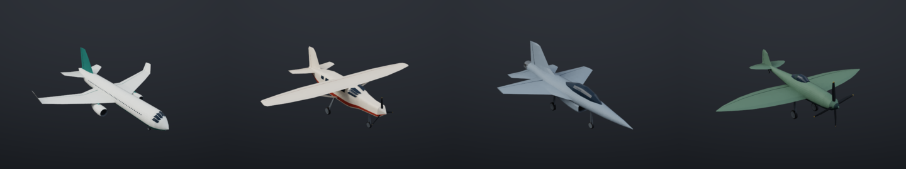

# Zuujis free game assets

Public-domain **CC0** game assets, including 24 free 3D aircraft models in GLB and six packs of 2D artwork. Use them in commercial or personal games. Credit is optional.

**[Browse previews for all seven packs](previews/README.md)**

## Downloads

| Download | Contents | Preview gallery |
| --- | --- | --- |
| [zuujis-aircraft-glb.zip](https://github.com/zuujiscom/free-game-assets/releases/download/v1.0.0/zuujis-aircraft-glb.zip) | 24 aircraft models in binary glTF (GLB) | [Preview](previews/aircraft/README.md) |
| [zuujis-from-the-ground-up-2d.zip](https://github.com/zuujiscom/free-game-assets/releases/download/v1.0.0/zuujis-from-the-ground-up-2d.zip) | Painted buildings, people, props, interface icons, and menu artwork | [Preview](previews/from-the-ground-up/README.md) |
| [zuujis-parallax-backgrounds.zip](https://github.com/zuujiscom/free-game-assets/releases/download/v1.0.0/zuujis-parallax-backgrounds.zip) | Six layered parallax scenes, clouds, and a scene index | [Preview](previews/backgrounds/README.md) |
| [zuujis-game-icons.zip](https://github.com/zuujiscom/free-game-assets/releases/download/v1.0.0/zuujis-game-icons.zip) | 128 icons, a sprite atlas, and editable vector sources | [Preview](previews/icons/README.md) |
| [zuujis-pixel-effects.zip](https://github.com/zuujiscom/free-game-assets/releases/download/v1.0.0/zuujis-pixel-effects.zip) | 48 effects strips with frame descriptions | [Preview](previews/effects/README.md) |
| [zuujis-tarot-art.zip](https://github.com/zuujiscom/free-game-assets/releases/download/v1.0.0/zuujis-tarot-art.zip) | 478 Tarot image files, including variants and resolutions | [Preview](previews/tarot/README.md) |
| [zuujis-covenant-hall.zip](https://github.com/zuujiscom/free-game-assets/releases/download/v1.0.0/zuujis-covenant-hall.zip) | 30 building sprites and four source keyframes | [Preview](previews/covenant-hall/README.md) |

The aircraft are self-contained glTF 2.0 binary models. They can be imported into Blender, Three.js, or other tools that support GLB. The Tarot download includes high-resolution images and is the largest pack.

[CC0 terms](LICENSE) · [Creator credits](CREDITS.md) · [All releases](https://github.com/zuujiscom/free-game-assets/releases)
