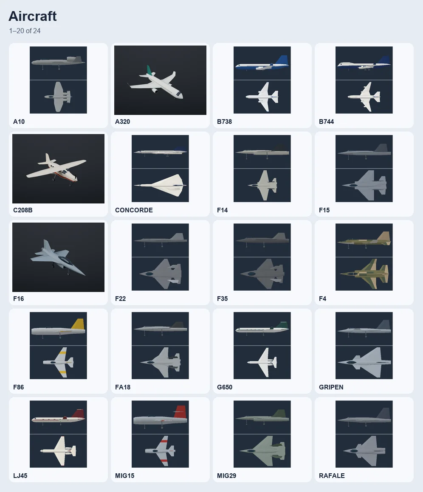
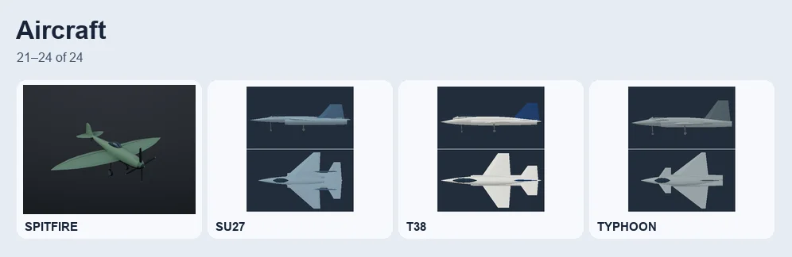

# Aircraft models

Rendered previews for all 24 GLB aircraft. Open any model’s individual view for more detail.

[Back to all packs](../../README.md) · [Download ZIP](https://github.com/zuujiscom/free-game-assets/releases/download/v1.0.0/zuujis-aircraft-glb.zip)

**Individual views**

[A10](individual/a10.webp) · [A320](individual/a320.webp) · [B738](individual/b738.webp) · [B744](individual/b744.webp) · [C208B](individual/c208b.webp) · [CONCORDE](individual/concorde.webp) · [F14](individual/f14.webp) · [F15](individual/f15.webp) · [F16](individual/f16.webp) · [F22](individual/f22.webp) · [F35](individual/f35.webp) · [F4](individual/f4.webp) · [F86](individual/f86.webp) · [FA18](individual/fa18.webp) · [G650](individual/g650.webp) · [GRIPEN](individual/gripen.webp) · [LJ45](individual/lj45.webp) · [MIG15](individual/mig15.webp) · [MIG29](individual/mig29.webp) · [RAFALE](individual/rafale.webp) · [SPITFIRE](individual/spitfire.webp) · [SU27](individual/su27.webp) · [T38](individual/t38.webp) · [TYPHOON](individual/typhoon.webp)

## Aircraft

File labels

- A10
- A320
- B738
- B744
- C208B
- CONCORDE
- F14
- F15
- F16
- F22
- F35
- F4
- F86
- FA18
- G650
- GRIPEN
- LJ45
- MIG15
- MIG29
- RAFALE
- SPITFIRE
- SU27
- T38
- TYPHOON

