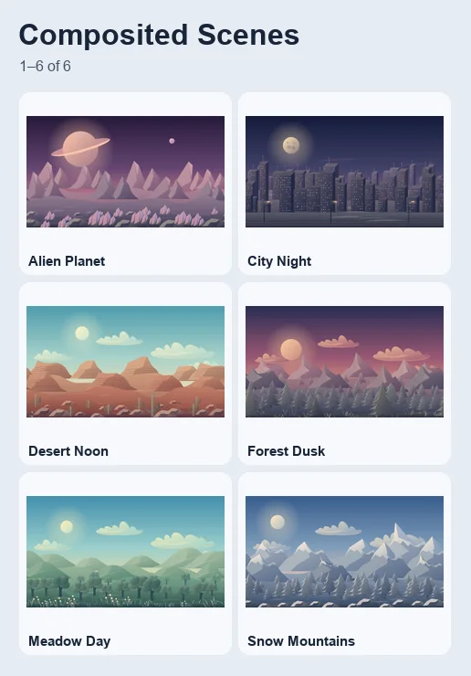
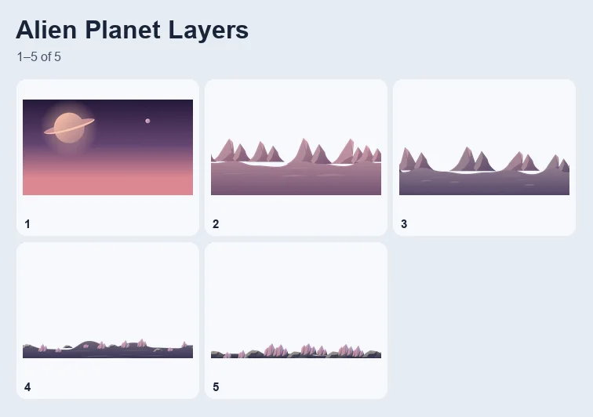
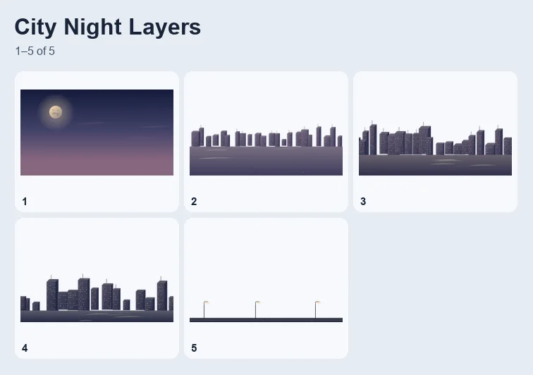
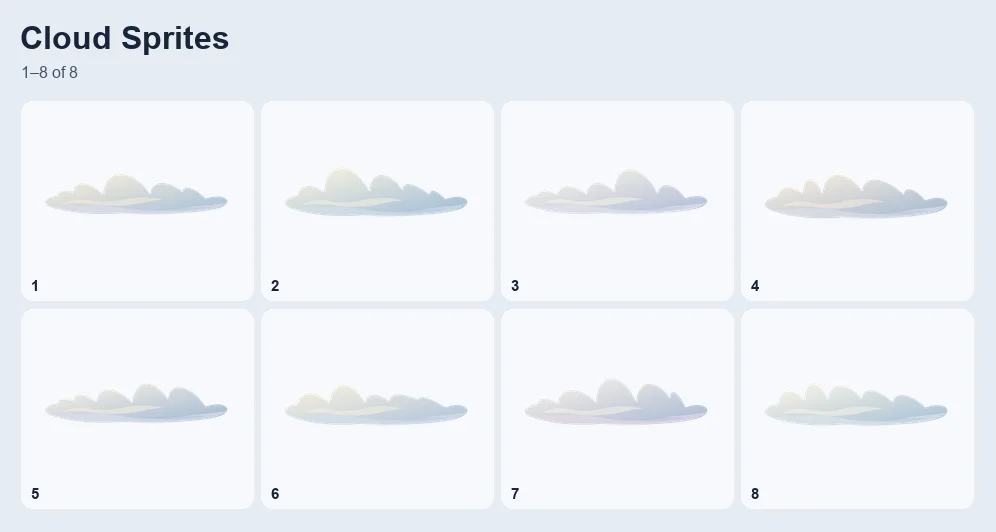
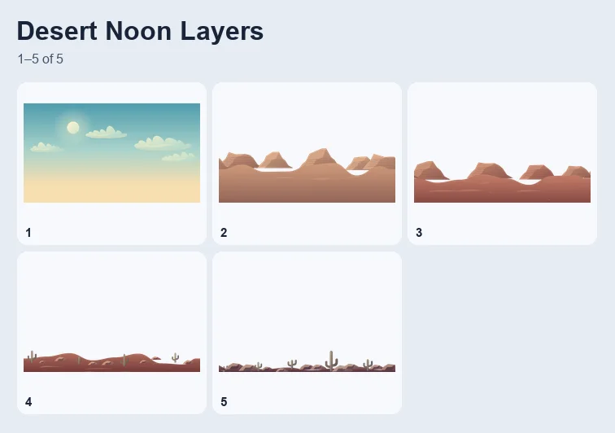
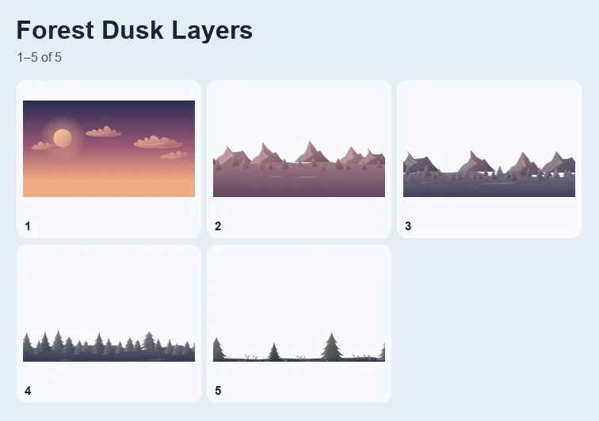
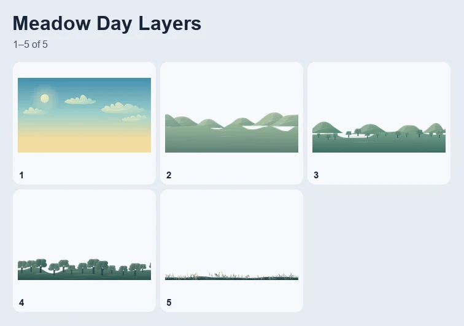
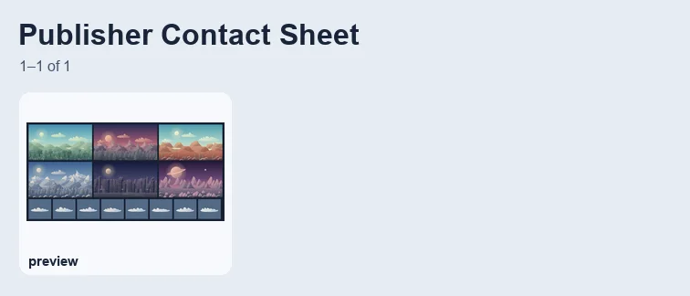
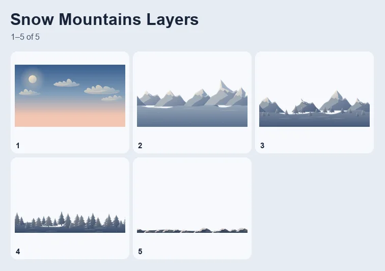

# Parallax backgrounds

All six scenes composited, plus each individual parallax layer and all cloud sprites.

[Back to all packs](../../README.md) · [Download ZIP](https://github.com/zuujis-cc0/free-game-assets/releases/download/v1.0.0/zuujis-parallax-backgrounds.zip)

**Full scenes**

[Alien Planet](scenes/alien-planet.webp) · [City Night](scenes/city-night.webp) · [Desert Noon](scenes/desert-noon.webp) · [Forest Dusk](scenes/forest-dusk.webp) · [Meadow Day](scenes/meadow-day.webp) · [Snow Mountains](scenes/snow-mountains.webp)

## Composited Scenes

File labels

- Alien Planet
- City Night
- Desert Noon
- Forest Dusk
- Meadow Day
- Snow Mountains

## Alien Planet Layers

File labels

- 1
- 2
- 3
- 4
- 5

## City Night Layers

File labels

- 1
- 2
- 3
- 4
- 5

## Cloud Sprites

File labels

- 1
- 2
- 3
- 4
- 5
- 6
- 7
- 8

## Desert Noon Layers

File labels

- 1
- 2
- 3
- 4
- 5

## Forest Dusk Layers

File labels

- 1
- 2
- 3
- 4
- 5

## Meadow Day Layers

File labels

- 1
- 2
- 3
- 4
- 5

## Publisher Contact Sheet

File labels

- preview

## Snow Mountains Layers

File labels

- 1
- 2
- 3
- 4
- 5

