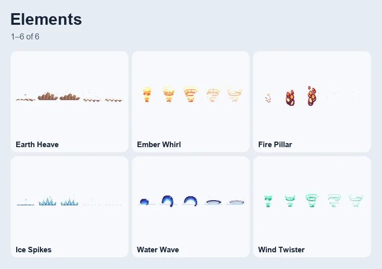
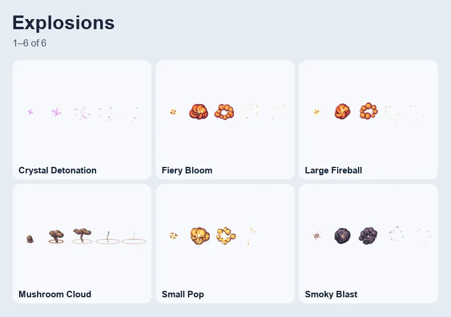
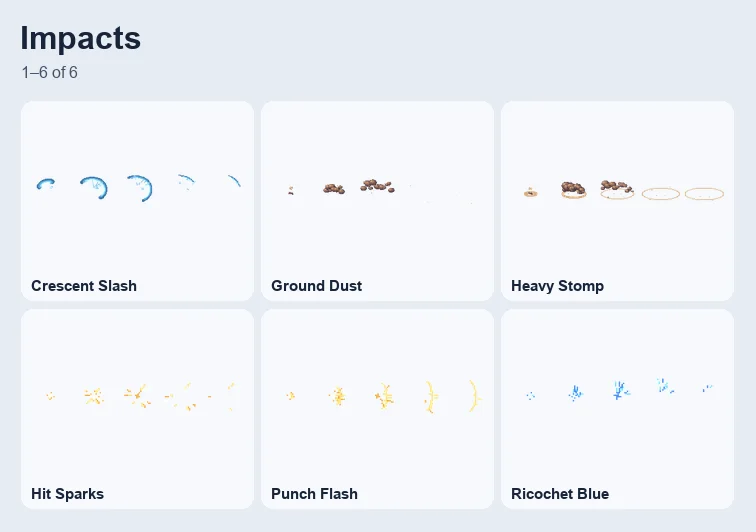
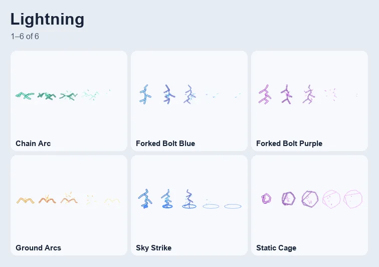
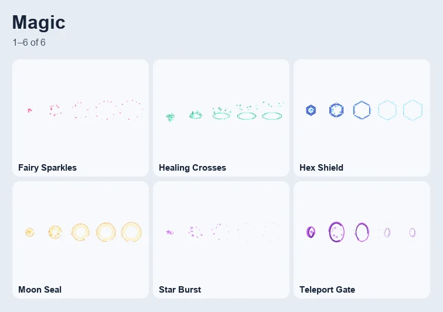
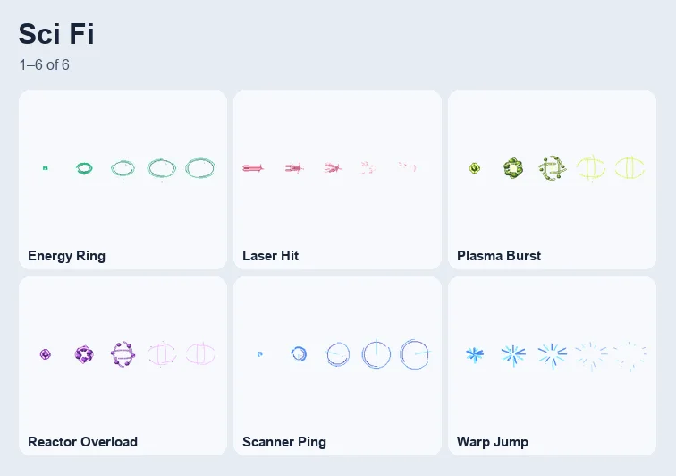
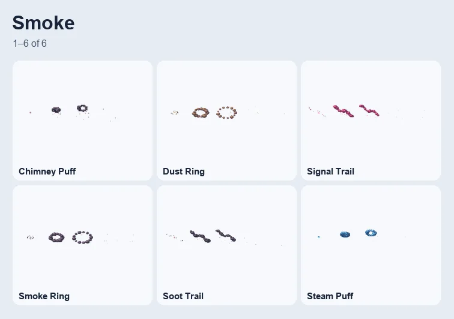
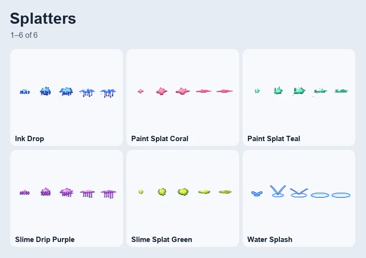

# Pixel effects

Five sampled frames per effect on the contact sheets. All 48 original sequences are also available as animated previews.

[Back to all packs](../../README.md) · [Download ZIP](https://github.com/zuujiscom/free-game-assets/releases/download/v1.0.0/zuujis-pixel-effects.zip)

[Browse all 48 animated previews](animation-index.md)

## Elements

File labels

- Earth Heave
- Ember Whirl
- Fire Pillar
- Ice Spikes
- Water Wave
- Wind Twister

## Explosions

File labels

- Crystal Detonation
- Fiery Bloom
- Large Fireball
- Mushroom Cloud
- Small Pop
- Smoky Blast

## Impacts

File labels

- Crescent Slash
- Ground Dust
- Heavy Stomp
- Hit Sparks
- Punch Flash
- Ricochet Blue

## Lightning

File labels

- Chain Arc
- Forked Bolt Blue
- Forked Bolt Purple
- Ground Arcs
- Sky Strike
- Static Cage

## Magic

File labels

- Fairy Sparkles
- Healing Crosses
- Hex Shield
- Moon Seal
- Star Burst
- Teleport Gate

## Sci Fi

File labels

- Energy Ring
- Laser Hit
- Plasma Burst
- Reactor Overload
- Scanner Ping
- Warp Jump

## Smoke

File labels

- Chimney Puff
- Dust Ring
- Signal Trail
- Smoke Ring
- Soot Trail
- Steam Puff

## Splatters

File labels

- Ink Drop
- Paint Splat Coral
- Paint Splat Teal
- Slime Drip Purple
- Slime Splat Green
- Water Splash

