# From the Ground Up

Every released sprite and menu image. Each building upgrade is shown separately.

[Back to all packs](../../README.md) · [Download ZIP](https://github.com/zuujiscom/free-game-assets/releases/download/v1.0.0/zuujis-from-the-ground-up-2d.zip)

## Menu Artwork

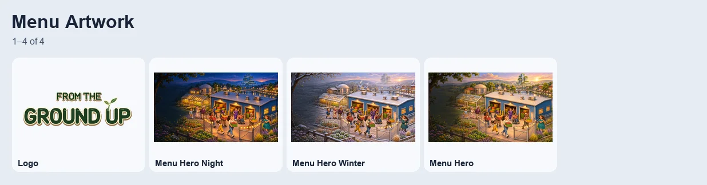

File labels

- Logo
- Menu Hero Night
- Menu Hero Winter
- Menu Hero

## Buildings

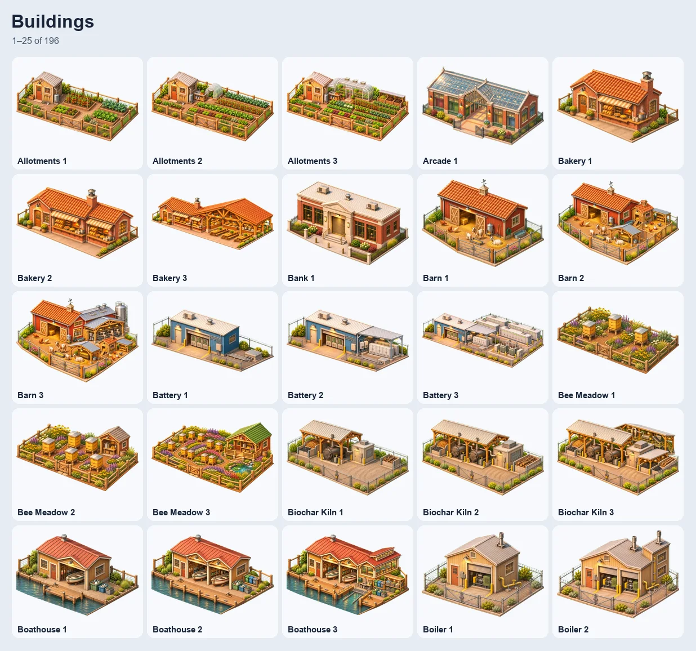

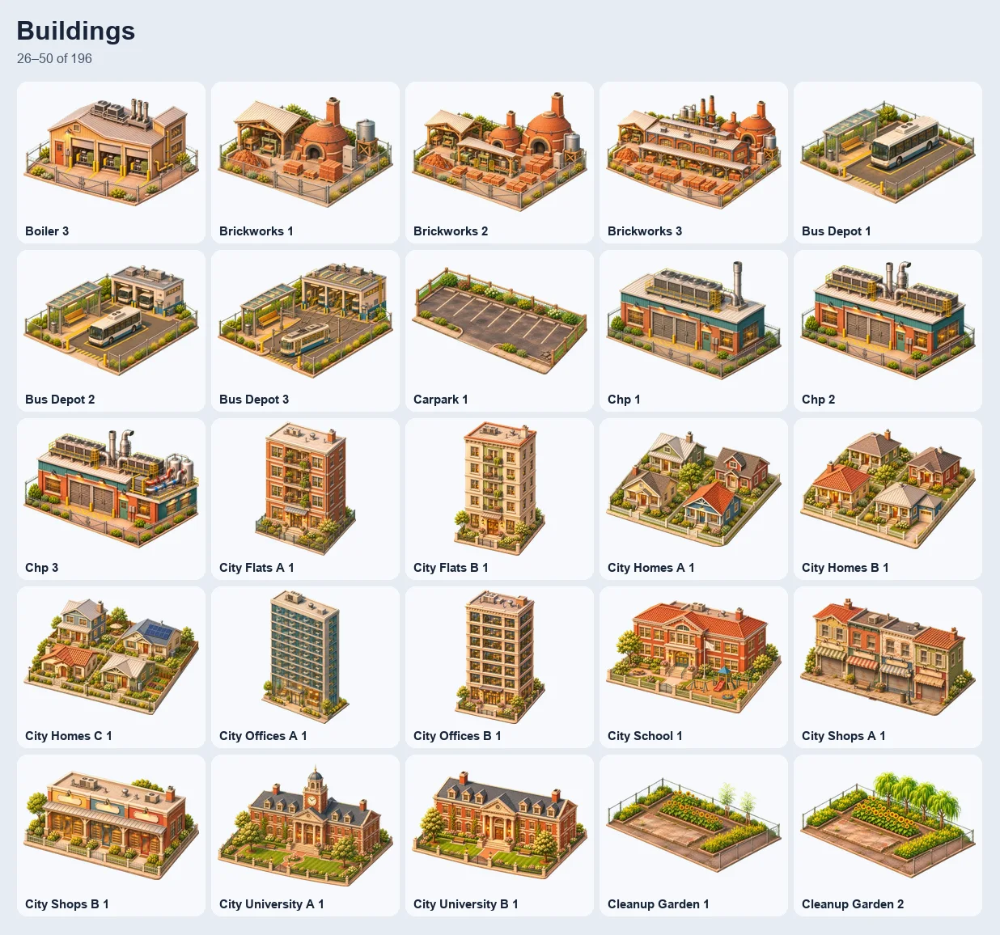

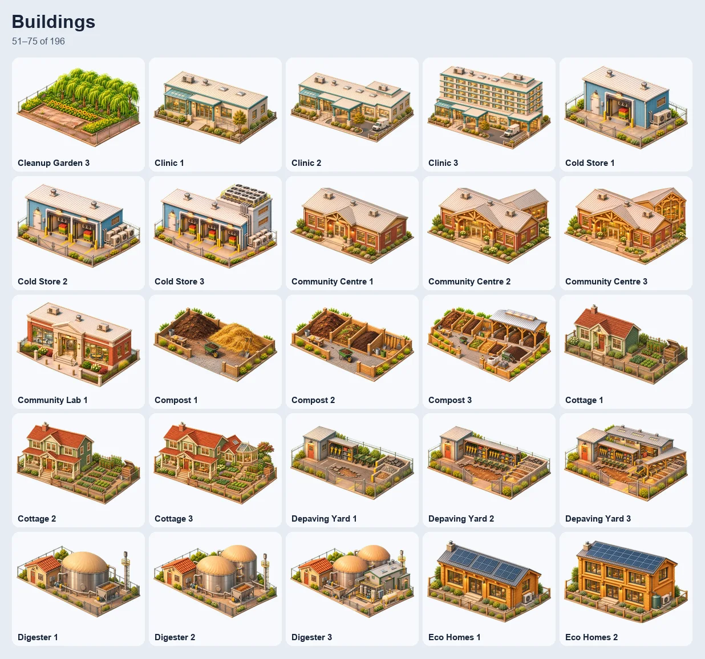

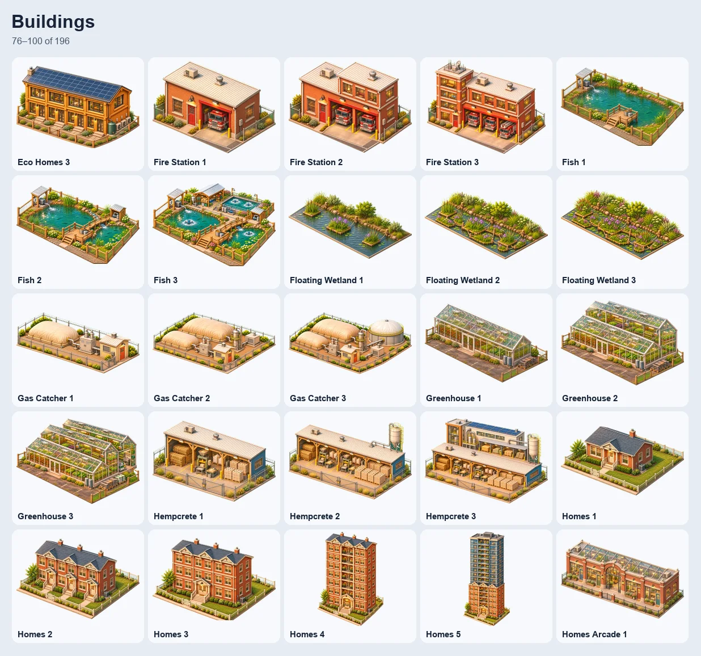

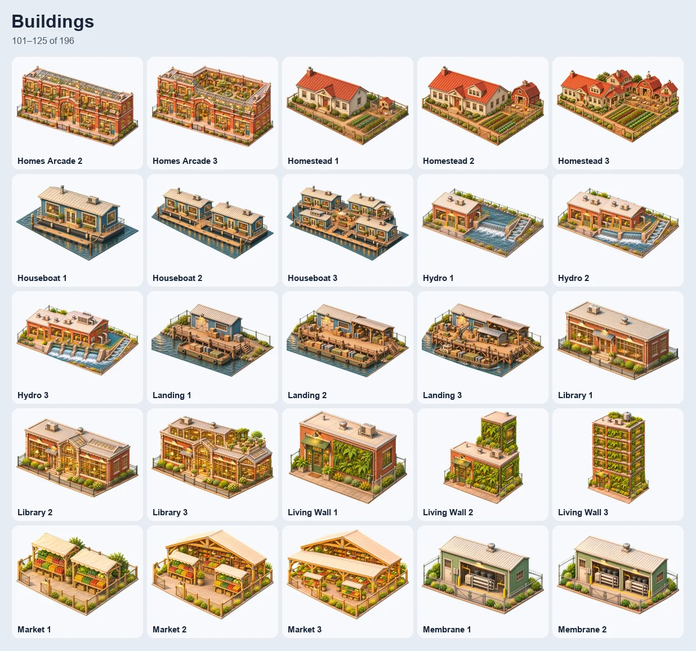

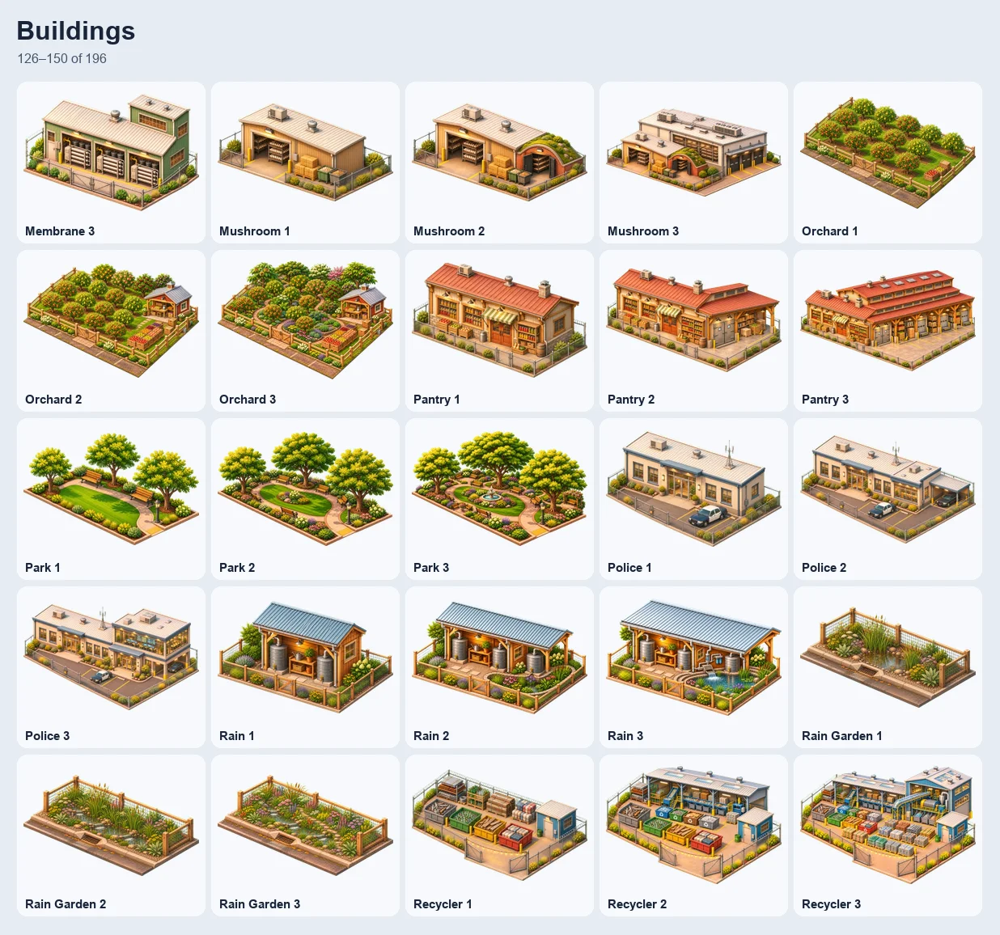

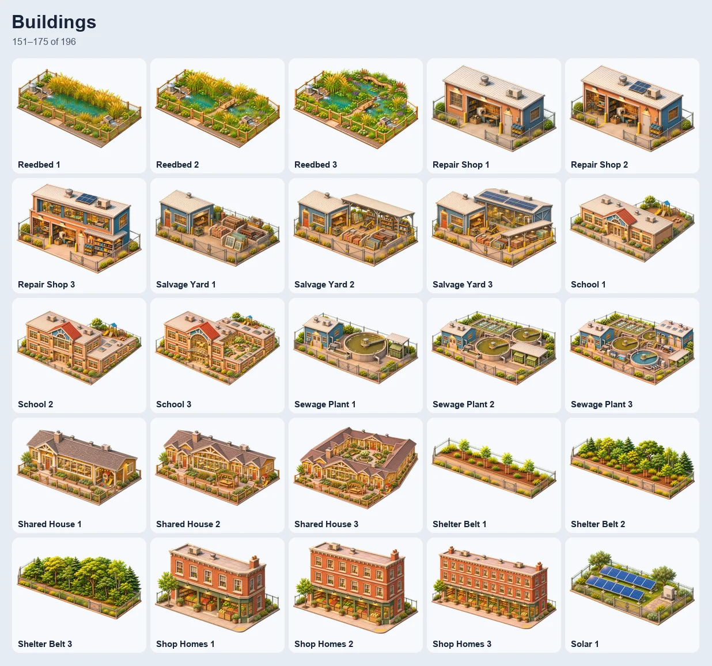

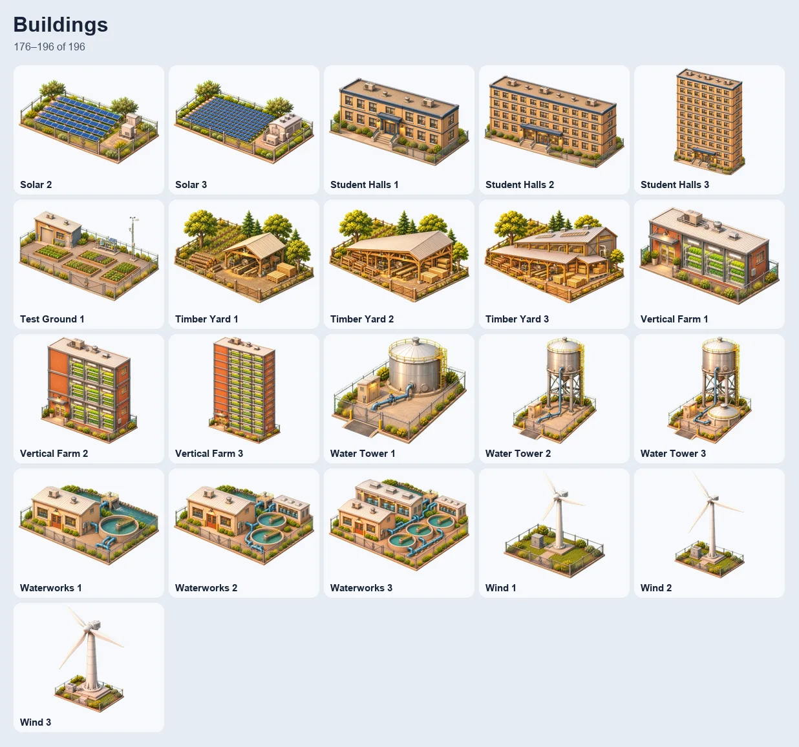

File labels

- Allotments 1
- Allotments 2
- Allotments 3
- Arcade 1
- Bakery 1
- Bakery 2
- Bakery 3
- Bank 1
- Barn 1
- Barn 2
- Barn 3
- Battery 1
- Battery 2
- Battery 3
- Bee Meadow 1
- Bee Meadow 2
- Bee Meadow 3
- Biochar Kiln 1
- Biochar Kiln 2
- Biochar Kiln 3
- Boathouse 1
- Boathouse 2
- Boathouse 3
- Boiler 1
- Boiler 2
- Boiler 3
- Brickworks 1
- Brickworks 2
- Brickworks 3
- Bus Depot 1
- Bus Depot 2
- Bus Depot 3
- Carpark 1
- Chp 1
- Chp 2
- Chp 3
- City Flats A 1
- City Flats B 1
- City Homes A 1
- City Homes B 1
- City Homes C 1
- City Offices A 1
- City Offices B 1
- City School 1
- City Shops A 1
- City Shops B 1
- City University A 1
- City University B 1
- Cleanup Garden 1
- Cleanup Garden 2
- Cleanup Garden 3
- Clinic 1
- Clinic 2
- Clinic 3
- Cold Store 1
- Cold Store 2
- Cold Store 3
- Community Centre 1
- Community Centre 2
- Community Centre 3
- Community Lab 1
- Compost 1
- Compost 2
- Compost 3
- Cottage 1
- Cottage 2
- Cottage 3
- Depaving Yard 1
- Depaving Yard 2
- Depaving Yard 3
- Digester 1
- Digester 2
- Digester 3
- Eco Homes 1
- Eco Homes 2
- Eco Homes 3
- Fire Station 1
- Fire Station 2
- Fire Station 3
- Fish 1
- Fish 2
- Fish 3
- Floating Wetland 1
- Floating Wetland 2
- Floating Wetland 3
- Gas Catcher 1
- Gas Catcher 2
- Gas Catcher 3
- Greenhouse 1
- Greenhouse 2
- Greenhouse 3
- Hempcrete 1
- Hempcrete 2
- Hempcrete 3
- Homes 1
- Homes 2
- Homes 3
- Homes 4
- Homes 5
- Homes Arcade 1
- Homes Arcade 2
- Homes Arcade 3
- Homestead 1
- Homestead 2
- Homestead 3
- Houseboat 1
- Houseboat 2
- Houseboat 3
- Hydro 1
- Hydro 2
- Hydro 3
- Landing 1
- Landing 2
- Landing 3
- Library 1
- Library 2
- Library 3
- Living Wall 1
- Living Wall 2
- Living Wall 3
- Market 1
- Market 2
- Market 3
- Membrane 1
- Membrane 2
- Membrane 3
- Mushroom 1
- Mushroom 2
- Mushroom 3
- Orchard 1
- Orchard 2
- Orchard 3
- Pantry 1
- Pantry 2
- Pantry 3
- Park 1
- Park 2
- Park 3
- Police 1
- Police 2
- Police 3
- Rain 1
- Rain 2
- Rain 3
- Rain Garden 1
- Rain Garden 2
- Rain Garden 3
- Recycler 1
- Recycler 2
- Recycler 3
- Reedbed 1
- Reedbed 2
- Reedbed 3
- Repair Shop 1
- Repair Shop 2
- Repair Shop 3
- Salvage Yard 1
- Salvage Yard 2
- Salvage Yard 3
- School 1
- School 2
- School 3
- Sewage Plant 1
- Sewage Plant 2
- Sewage Plant 3
- Shared House 1
- Shared House 2
- Shared House 3
- Shelter Belt 1
- Shelter Belt 2
- Shelter Belt 3
- Shop Homes 1
- Shop Homes 2
- Shop Homes 3
- Solar 1
- Solar 2
- Solar 3
- Student Halls 1
- Student Halls 2
- Student Halls 3
- Test Ground 1
- Timber Yard 1
- Timber Yard 2
- Timber Yard 3
- Vertical Farm 1
- Vertical Farm 2
- Vertical Farm 3
- Water Tower 1
- Water Tower 2
- Water Tower 3
- Waterworks 1
- Waterworks 2
- Waterworks 3
- Wind 1
- Wind 2
- Wind 3

## Icons

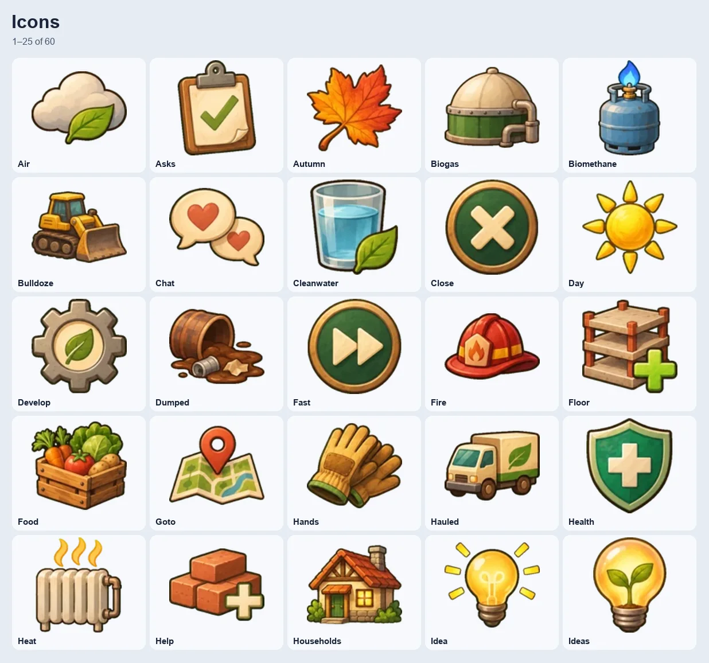

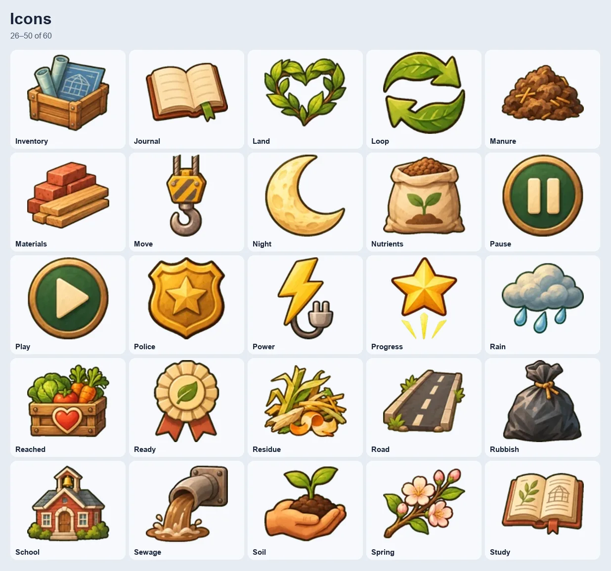

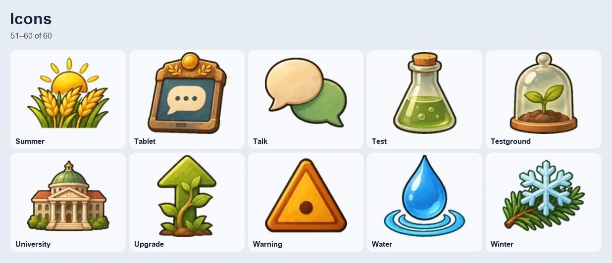

File labels

- Air
- Asks
- Autumn
- Biogas
- Biomethane
- Bulldoze
- Chat
- Cleanwater
- Close
- Day
- Develop
- Dumped
- Fast
- Fire
- Floor
- Food
- Goto
- Hands
- Hauled
- Health
- Heat
- Help
- Households
- Idea
- Ideas
- Inventory
- Journal
- Land
- Loop
- Manure
- Materials
- Move
- Night
- Nutrients
- Pause
- Play
- Police
- Power
- Progress
- Rain
- Reached
- Ready
- Residue
- Road
- Rubbish
- School
- Sewage
- Soil
- Spring
- Study
- Summer
- Tablet
- Talk
- Test
- Testground
- University
- Upgrade
- Warning
- Water
- Winter

## Landmarks

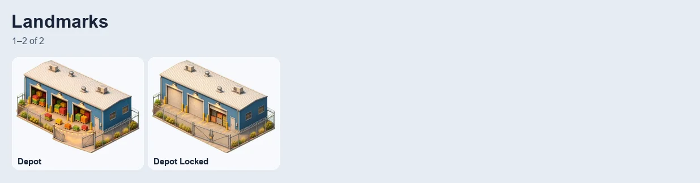

File labels

- Depot
- Depot Locked

## People

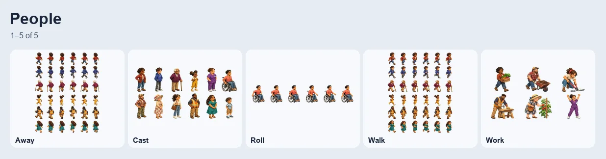

File labels

- Away
- Cast
- Roll
- Walk
- Work

## Props

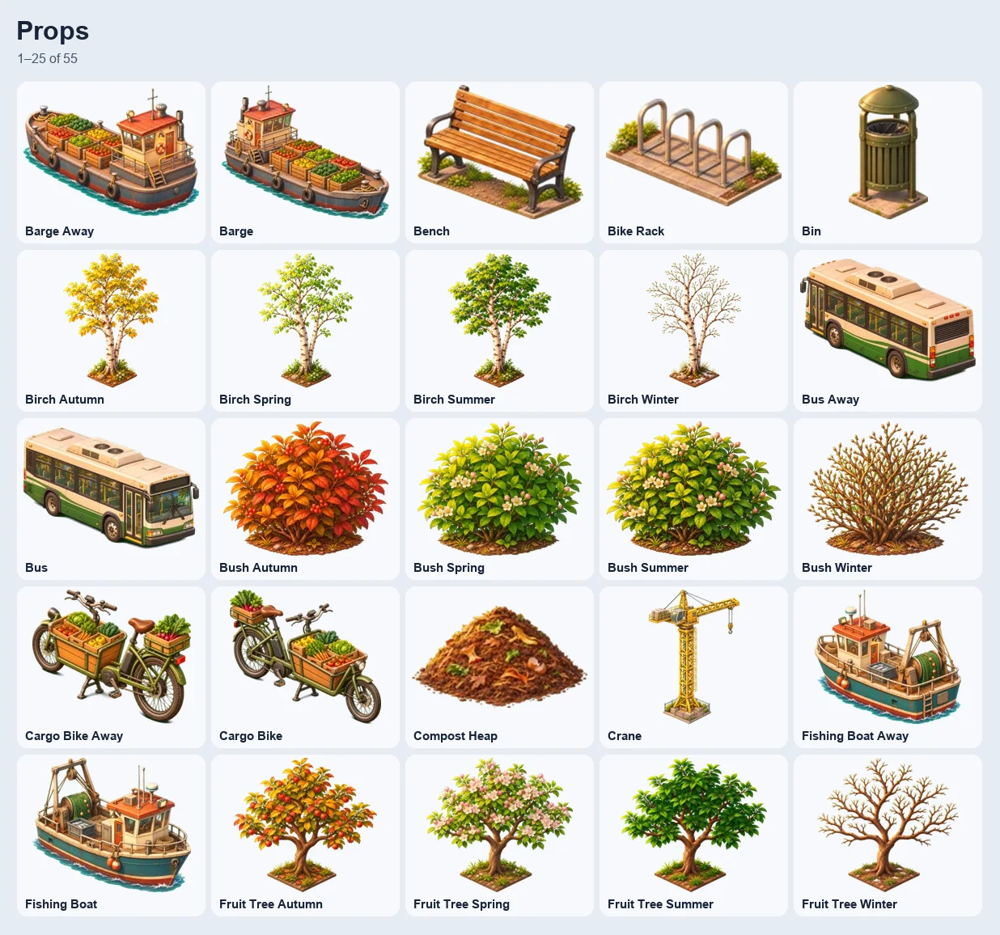

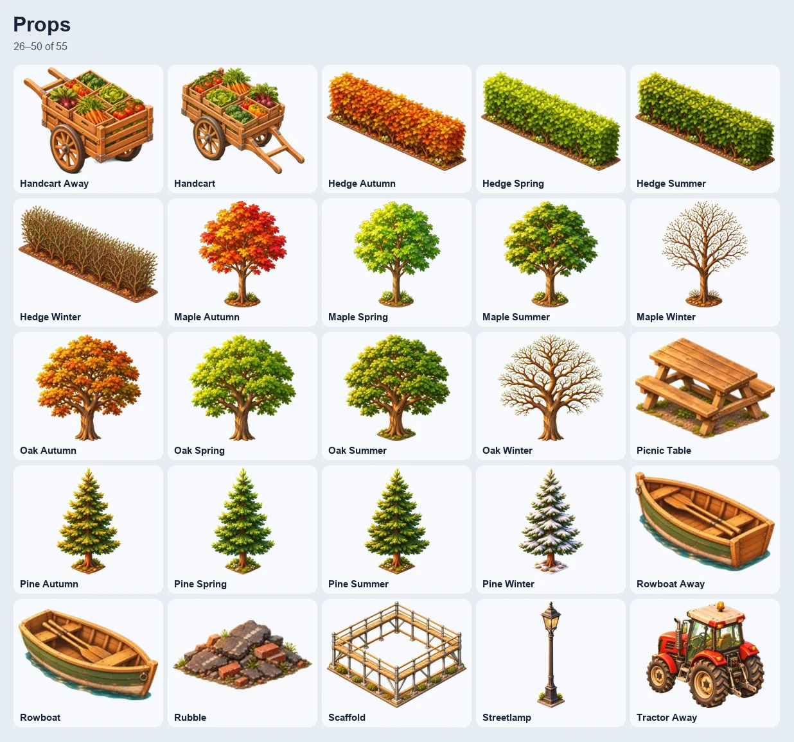

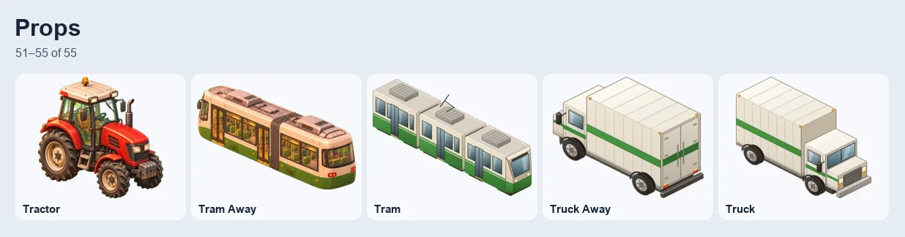

File labels

- Barge Away
- Barge
- Bench
- Bike Rack
- Bin
- Birch Autumn
- Birch Spring
- Birch Summer
- Birch Winter
- Bus Away
- Bus
- Bush Autumn
- Bush Spring
- Bush Summer
- Bush Winter
- Cargo Bike Away
- Cargo Bike
- Compost Heap
- Crane
- Fishing Boat Away
- Fishing Boat
- Fruit Tree Autumn
- Fruit Tree Spring
- Fruit Tree Summer
- Fruit Tree Winter
- Handcart Away
- Handcart
- Hedge Autumn
- Hedge Spring
- Hedge Summer
- Hedge Winter
- Maple Autumn
- Maple Spring
- Maple Summer
- Maple Winter
- Oak Autumn
- Oak Spring
- Oak Summer
- Oak Winter
- Picnic Table
- Pine Autumn
- Pine Spring
- Pine Summer
- Pine Winter
- Rowboat Away
- Rowboat
- Rubble
- Scaffold
- Streetlamp
- Tractor Away
- Tractor
- Tram Away
- Tram
- Truck Away
- Truck

## Tower

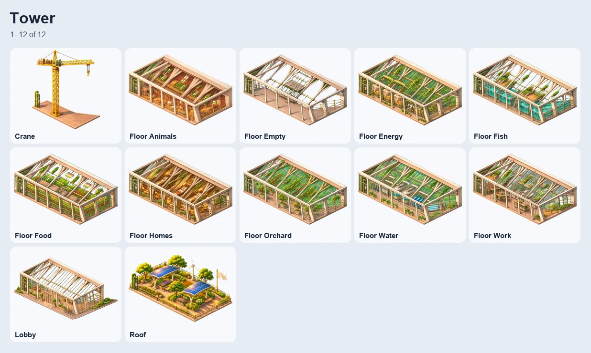

File labels

- Crane
- Floor Animals
- Floor Empty
- Floor Energy
- Floor Fish
- Floor Food
- Floor Homes
- Floor Orchard
- Floor Water
- Floor Work
- Lobby
- Roof

